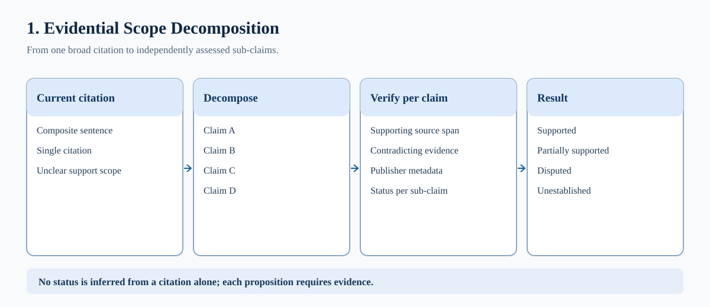
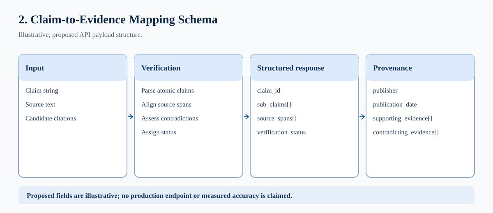
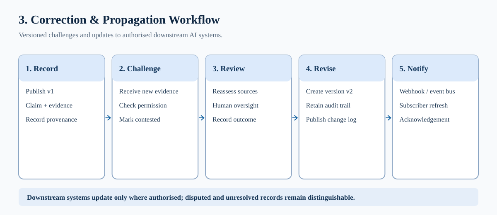

# Claim-to-Evidence Coverage and Contradiction API
## Architectural Specification — Working Draft

**Author:** Grace R. Nettey — Manifold Grace  
**Concept circulation:** 1 November 2026  
**Revision:** 2 November 2026  
**Status:** Editable working draft; not peer reviewed; no DOI assigned  
**Intended audience:** Hugging Face and wider AI governance / developer community

## 1. Executive summary

This working specification proposes a claim-to-evidence coverage and contradiction interface that decomposes compound assertions into independently assessable propositions. Each proposition may be linked to exact evidence spans, published source metadata, explicit support or contradiction statuses, independent review context, and a versioned correction history. The longer-term ambition is governed interoperability among participating retrieval and AI systems, rather than a claim that existing tools cannot perform any sub-claim verification.

## 2. Problem and scope

A citation attached to a compound sentence can conceal partial support: evidence for a reported date may not establish a claimed motivation or causal effect. A separate problem arises when information is undocumented or inaccessible; “not established by available evidence” should not be conflated with “false”. Verification results also vary across workflows, permissions and time, making their reuse and correction difficult without common semantics and accountable stewardship.

## 3. Proposed technical behaviour

An opt-in interface could accept an assertion, decompose it into atomic claims, retrieve authorised evidence, map precise supporting and contradicting source spans, and return typed statuses. Proposed states include supported, partially supported, disputed, not established, and pending review. The schema would record scope of assessment, provenance, publisher identity, review method, timestamps, dependencies, permissions and version identifiers. Publisher reputation alone would not be proof of truth; independent corroboration and methodological accountability remain necessary.



## 4. Illustrative API design

The endpoint paths and payload below are hypothetical examples, not existing Hugging Face services or a settled standard. An interoperable specification should separate claims, evidence, review decisions and event notifications, with clear authentication and access controls.

Proposed operations (illustrative only):

```http
GET /v1/evidence/claims/{claim_id}
POST /v1/evidence/search
GET /v1/evidence/claims/{claim_id}/history
POST /v1/evidence/claims/{claim_id}/challenges
```

Illustrative JSON response:

```json
{
  "claim_id": "illustrative-0091",
  "version": 2,
  "sub_claims": [
    {
      "id": "0091-A",
      "text": "A policy changed in March",
      "status": "supported",
      "source_spans": ["source-id:section:paragraph"],
      "review_status": "reviewed"
    },
    {
      "id": "0091-B",
      "text": "The change caused a 20% improvement",
      "status": "not_established",
      "source_spans": [],
      "review_status": "pending"
    }
  ],
  "publisher_metadata": {"publisher_id": "illustrative-curator"},
  "history": {"supersedes": 1, "updated_at": "2026-11-02"}
}
```



## 5. Correction and propagation

Authorised challenges should trigger re-evaluation, record the decision and rationale, preserve prior versions, and issue a machine-readable correction event. Downstream services could query or subscribe to version changes, subject to permissions. Notifications do not guarantee deletion of previously generated answers or automatic acceptance by independent services. Correction decisions should have an auditable human-review path for consequential cases.



## 6. Fit within the Hugging Face ecosystem

Potential integration targets include Hub repository metadata, community discussion, evaluation datasets, optional client-side APIs and independently hosted verification services. This paper does not assert that the Hub currently supplies the proposed end-to-end service, nor that Hugging Face has agreed to build it. A practical next step would be a narrow API contract and reference prototype with an explicit compatibility and maintenance model.

## 7. Related work and distinction

Existing research already performs granular evidence checking. FEVER provides supported/refuted/not-enough-information labels with annotated evidence; AVeriTeC covers real-world claims and evidence-backed questions. W3C provenance representations and the C2PA content-provenance specification supply relevant, though different, building blocks. The proposed research direction is a governed, versioned, permission-aware, reusable interoperability layer connecting claim-specific decisions and corrections—not the invention of fact checking or provenance in isolation.

## 8. Evaluation and risks

Evaluation should test atomic-claim extraction, evidence-span alignment, contradiction recall, calibration, source-independence detection, revision propagation, reviewer agreement, privacy leakage, latency and interoperability. Key risks include mistaken authority assignments, circular citation chains, wrongful determinations, sensitive source disclosure, reviewer conflicts of interest, staleness and feedback-loop amplification. Independent benchmarking and governance design are required before any operational reliability claims.

## 9. Provenance, revision and disclosure

Conceptual research and proposal direction: Grace R. Nettey, Manifold Grace. AI assistance was used for drafting, terminology and diagrams. Prior related research is acknowledged below; conceptual authorship does not by itself establish exclusive intellectual-property rights or a causal link to later platform implementations. Initial circulation: 1 November 2026. Working revision: 2 November 2026. Status: editable draft, not peer reviewed or implemented. No DOI has been assigned.

## Selected references

- [FEVER dataset](https://fever.ai/dataset/fever.html)
- [AVeriTeC dataset](https://fever.ai/dataset/averitec.html)
- [W3C provenance overview](https://www.w3.org/TR/prov-overview/)
- [C2PA specification](https://spec.c2pa.org/specifications/)
- [Hugging Face model card metadata](https://huggingface.co/docs/hub/model-cards)
- [Hugging Face forum proposal](https://discuss.huggingface.co/t/claim-to-evidence-coverage-and-contradiction-api/191321)

## Publication notes

Working draft for author revision. A Zenodo archive requires a tagged GitHub release from a Zenodo-enabled repository; do not treat this commit as an archival publication.
